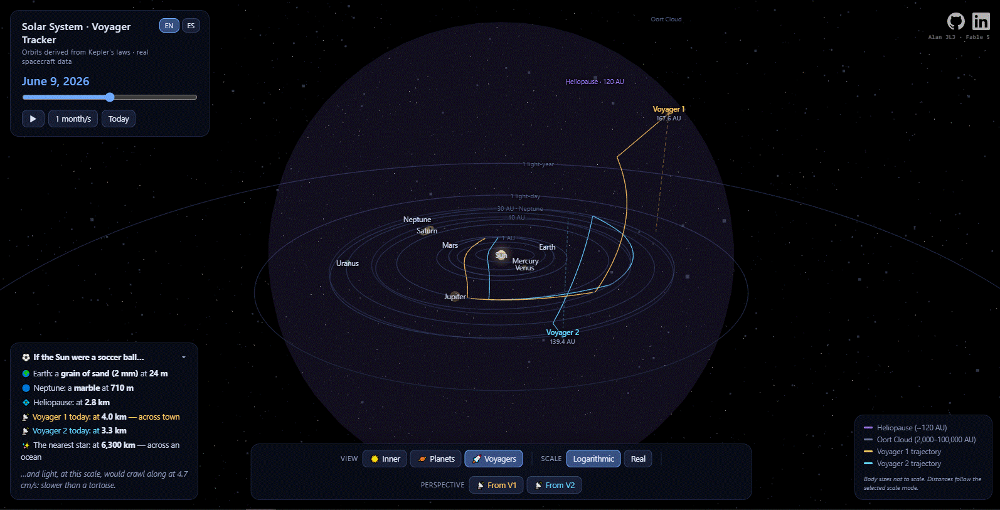

# 🛰️ Sistema Solar 3D · Rastreador Voyager

**Una visualización 3D interactiva del sistema solar, impulsada por física real, que rastrea la posición verdadera de las Voyager 1 y 2 en el espacio interestelar — hoy, y en cualquier fecha entre 1977 y 2076.**

[](#)
[](#-licencia)
[](https://www.anthropic.com/claude/fable)

🌐 **[Read this in English →](README.md)**

---

## 📸 Demo / Vista previa



> **Para agregar la vista previa:** crea una carpeta `assets/`, graba una captura corta de la app (por ejemplo con [ScreenToGif](https://www.screentogif.com/) o `Win + Alt + R`), guárdala como `assets/demo.gif`, y la imagen de arriba se mostrará automáticamente.

---

## 🌌 Acerca del Proyecto

La mayoría de los diagramas del sistema solar te mienten. No les queda alternativa: a escala real, si el Sol fuera un balón de fútbol, la Tierra sería un grano de arena a 24 metros, y las sondas Voyager estarían al otro lado de tu ciudad.

Este proyecto se niega a aplanar esa verdad. Es un **único archivo HTML autocontenido** que renderiza el sistema solar en proporción real, deriva cada órbita planetaria de las **leyes de Kepler** (sin posiciones precalculadas) y ubica a la **Voyager 1 (~172 AU, rumbo a Ofiuco)** y a la **Voyager 2 (~144 AU, rumbo a Pavo)** usando sus velocidades heliocéntricas reales y sus trayectorias asintóticas — incluidas las asistencias gravitatorias que doblaron su camino en Júpiter, Saturno, Urano y Neptuno.

El objetivo es simple y ambicioso: que cualquier persona — un estudiante de preparatoria, un reclutador, tú — pueda pasar cinco minutos dentro y salir *sintiendo* la escala del espacio y la magnitud de lo que lograron las misiones Voyager.

Lo que lo hace especial:

- **Física real, no fotogramas de animación.** Las posiciones planetarias se resuelven cada cuadro a partir de elementos orbitales mediante la ecuación de Kepler; los períodos orbitales emergen de la tercera ley de Kepler y las velocidades de la ecuación vis-viva.
- **Datos reales de las sondas.** Las distancias, rumbos, velocidades, fechas de lanzamiento y cruces de la heliopausa coinciden con el registro publicado de la misión.
- **Escala intercambiable.** El modo logarítmico permite ver Mercurio y el espacio interestelar en una sola vista; el modo lineal ("real") muestra cómo los planetas se desvanecen en un punto dentro de la heliosfera — que es exactamente la idea.
- **La vista desde la propia sonda.** El modo "Perspectiva Voyager" coloca la cámara a bordo de cada nave, donde el Sol queda reducido a la estrella más brillante de un cielo negro.

---

## ✨ Funcionalidades

- 🪐 **Motor orbital kepleriano** — los 8 planetas propagados desde elementos orbitales J2000 del JPL, resueltos numéricamente cada cuadro
- 🚀 **Rastreo en vivo de Voyager 1 y 2** — distancia, tiempo-luz y velocidad reales para cualquier fecha simulada
- 🛤️ **Trayectorias históricas** — rutas de vuelo trazadas desde el lanzamiento (1977), pasando por cada asistencia gravitatoria real, hasta la fecha actual
- ⏱️ **Máquina del tiempo** — recorre de 1977 a 2076, o reproduce a velocidades de 1 día/s hasta 5 años/s
- 🔭 **Modo Perspectiva Voyager** — ve el Sol como un punto de luz a 165 AU, con cifras en vivo de brillo y retraso de la luz
- 📏 **Doble modo de escala** — logarítmica (todo en una vista) vs. proporción real (siente el vacío)
- 🫧 **Contexto interestelar** — heliopausa (~120 AU), nube de Oort (2,000–100,000 AU), anillos de referencia de día-luz y año-luz
- 🖱️ **Exploración libre total** — rota, acerca y desplaza; haz clic en cualquier cuerpo para abrir su panel de datos en vivo; pasa el cursor para ver distancia, tiempo-luz y velocidad
- ⚽ **Tarjeta de escala tangible** — comparaciones tipo "si el Sol fuera un balón de fútbol…", actualizadas en vivo con la fecha de simulación
- 🌐 **Interfaz bilingüe** — inglés por defecto, español con un clic, cubriendo cada etiqueta hasta las anotaciones 3D dentro de la escena
- 📦 **Cero instalación** — un archivo HTML, sin backend, sin paso de compilación

---

## 🌌 Modo Universo a escala (`universo.html`)

Un segundo modo, a un clic desde el panel superior izquierdo: **el universo en tus manos**. Un zoom continuo a lo largo de 21 potencias de diez — de la Tierra y la Luna al borde del universo observable y más allá — con cada objeto en su posición real y a su tamaño real.

- 🔭 **11 paradas en una regla de potencias de diez** — Tierra y Luna, planetas interiores, sistema solar y Voyagers, Nube de Oort, estrellas cercanas, vecindario estelar, Vía Láctea, Grupo Local, Laniakea y la red cósmica, el universo observable y *qué hay después*
- 🌍 **Posiciones reales** — planetas con el mismo motor kepleriano, la Luna en su posición y fase de hoy, la Tierra rotada según la hora sidérea, ~40 estrellas y ~20 galaxias ubicadas por su ascensión recta, declinación y distancia, y el universo lejano (TON 618, Earendel, GN-z11, JADES-GS-z14-0, MoM-z14) a distancias comóviles cosmológicas
- 🎯 **Vuela a lo que quieras** — haz clic en una estrella como Betelgeuse y la cámara viaja hasta ella a escala real, con las órbitas de la Tierra y Júpiter y un Sol a escala dibujados al lado para comparar
- ⚖️ **Comparador** — tamaños (de la Luna al universo observable, con "cuántos caben dentro" y analogías con un balón) y distancias entre dos objetos cualesquiera (tiempos para la luz, el Voyager 1, un avión, un auto y caminando)
- 🕰️ **Contexto histórico de la luz** — para cada objeto, qué pasaba en la Tierra cuando salió la luz que ves de él
- 💡 **Datos curiosos por escala** — más de 45 datos verificados, incluidos resultados recientes (Voyager 1 a un día-luz, los planetas de la Estrella de Barnard, la compañera de Betelgeuse, la probabilidad de fusión con Andrómeda de 2025, MoM-z14, DESI)
- ❓ **Panel "¿Qué hay después?"** — horizontes, el fondo cósmico de microondas, el universo no observable y el multiverso, cada uno marcado como *comprobado*, *probable* o *especulativo*
- 💡 **Simulación del viaje de la luz** — observa cómo la luz cruza un universo en expansión (ΛCDM plano, Planck 2018): desde el Cúmulo de Coma, 3C 273, TON 618, Earendel, GN-z11, MoM-z14 o el fondo cósmico hasta nosotros, o un mensaje de radio que enviamos hoy. Incluye una "regla elástica" animada, un diagrama espacio-tiempo con la esfera de Hubble, el estiramiento de la longitud de onda en vivo (por qué el JWST ve en infrarrojo) y las tres distancias que importan: cuando salió la luz, el camino que recorrió y dónde está el objeto hoy. También muestra por qué la luz de las galaxias más lejanas al principio se *alejaba* de nosotros, y por qué las galaxias a más de ~16,600 millones de años-luz nunca podrán recibir un mensaje nuestro
- ▶ **Recorrido guiado** — un viaje automático de la Tierra al borde de todo

La estructura espiral de la Vía Láctea y la red cósmica son ilustraciones científicas (nunca hemos fotografiado nuestra galaxia desde afuera); los objetos con nombre están en sus posiciones medidas.

---

## 🛠️ Construido Con

| Tecnología | Rol |
|---|---|
| [Three.js](https://threejs.org/) r160 | Renderizado WebGL, controles de cámara (`OrbitControls`), etiquetas ancladas en HTML (`CSS2DRenderer`) |
| JavaScript puro (Módulos ES) | Lógica de la aplicación, solucionador de Kepler, i18n — sin frameworks |
| HTML5 + CSS3 | Entrega en un solo archivo, paneles de interfaz con glassmorphism |
| Datos de NASA / JPL | Elementos orbitales y parámetros de la misión Voyager (ver [Fuentes de Datos](#-fuentes-de-datos)) |

### Acerca de Claude Fable 5

Este proyecto fue construido con **[Claude Fable 5](https://www.anthropic.com/claude/fable)**, el primer modelo clase Mythos de Anthropic disponible al público (lanzado en junio de 2026). Fable 5 fue el motor principal de ingeniería del proyecto: diseñó la arquitectura, implementó la mecánica kepleriana y el modelo de trayectorias, escribió e iteró el código de renderizado e interfaz, y verificó visualmente cada build en un navegador headless hasta que el resultado coincidió con la intención. El autor dirigió la visión, los requisitos y la revisión; Fable 5 hizo el trabajo pesado en el teclado.

---

## 🚀 Cómo Empezar

Dos archivos HTML autocontenidos (`index.html` para el rastreador Voyager y `universo.html` para el modo Universo a escala). Sin instalación, sin dependencias, sin paso de compilación.

**Opción 1 — Simplemente ábrelo**

```
Doble clic en index.html
```

Eso es todo. Se necesita conexión a internet en la primera carga (Three.js se descarga desde un CDN).

**Opción 2 — Sírvelo localmente** (recomendado si tu navegador restringe archivos locales)

```bash
# Python
python -m http.server 8000

# o Node
npx serve .
```

Luego abre `http://localhost:8000`.

**Controles:** arrastra para rotar · rueda para acercar · clic en cualquier cuerpo para ver detalles · usa la barra inferior para vistas, modos de escala y perspectivas Voyager · usa el panel superior izquierdo para viajar en el tiempo.

---

## 📡 Fuentes de Datos

- **Elementos orbitales planetarios** — [JPL "Approximate Positions of the Planets"](https://ssd.jpl.nasa.gov/planets/approx_pos.html) (elementos keplerianos, época J2000)
- **Referencia de efemérides** — [Sistema Horizons de NASA/JPL](https://ssd.jpl.nasa.gov/horizons/)
- **Distancias, velocidades y trayectoria de las Voyager** — [NASA JPL Voyager Mission Status](https://voyager.jpl.nasa.gov/mission/status/)
- **Cruces de la heliopausa** — anuncios de la NASA: Voyager 1 (25 ago 2012), Voyager 2 (5 nov 2018)
- **Estrellas, galaxias y cosmología (modo Universo)** — posiciones de las coordenadas de catálogo SIMBAD/NED; distancias al universo lejano calculadas para ΛCDM plano con parámetros de Planck 2018 (H₀ = 67.7 km/s/Mpc, Ωm = 0.311); resultados recientes de NASA, ESA, NOIRLab y anuncios revisados por pares (2024–2026)
- **Constantes físicas** — definiciones de la IAU (1 AU = 149,597,870.7 km; c = 299,792.458 km/s)

El movimiento planetario se *deriva* de estos elementos resolviendo la ecuación de Kepler en tiempo de ejecución — ninguna posición está precalculada. Las posiciones de las Voyager usan sus velocidades heliocéntricas publicadas y sus direcciones asintóticas (Ofiuco, +35° de latitud eclíptica para la V1; Pavo, −48° para la V2), con trayectorias que pasan por las posiciones verdaderas de los planetas en cada fecha histórica de sobrevuelo.

---

## 👨‍🚀 Autor

**Alan Jesús López Jacinto**

- GitHub: [@alanjlj2202](https://github.com/alanjlj2202)
- LinkedIn: [Alan Jesús López Jacinto](https://www.linkedin.com/in/alan-jesús-lópez-jacinto-66a699253/)

---

## 🙏 Agradecimientos

- **[Anthropic](https://www.anthropic.com/)** y el equipo de **Claude Fable 5** — por construir un modelo capaz de convertir una idea sobre la escala cósmica en software funcional y verificado dentro de una sola conversación.
- **La misión Voyager de la NASA** — casi cinco décadas de ingeniería, y los dos embajadores más lejanos que la humanidad ha enviado jamás. El Disco de Oro sigue allá afuera, alejándose a 17 km/s.
- **Los contribuidores de [Three.js](https://threejs.org/)**, por hacer que WebGL se sienta como escritura creativa.

> *"La nave será encontrada y el disco será escuchado solo si existen civilizaciones avanzadas que viajen por el espacio interestelar. Pero lanzar esta botella al océano cósmico dice algo muy esperanzador sobre la vida en este planeta."* — Carl Sagan


## Historia viva (`historia.html`)

Módulo educativo en español con diez capítulos desde la formación de la Tierra hasta la industrialización británica. Incluye escenarios regionales ilustrados, habitantes animados seleccionables, clima y paisaje, conexiones evolutivas, preguntas con explicación y recorrido automático. Accesible desde los módulos Voyager y Universo.

Ejecuta `python -m http.server 8000` y abre `http://localhost:8000/historia.html`. No requiere dependencias ni claves API. Los habitantes usan reglas locales de movimiento; no hay IA generativa. Los símbolos son representaciones estilizadas, no modelos anatómicos. La línea del tiempo avanza por capítulos y no usa una escala temporal proporcional. Incluye selección por botones, pausa y respeto inicial a la preferencia de movimiento reducido.

Las escenas culturales son regionales: no representan una secuencia universal de progreso ni evolución biológica. Las referencias de consulta se encuentran al pie del módulo.

### Recorrido en primera persona

Pulsa **Entrar en primera persona** para recorrer cualquiera de los diez escenarios 3D. Usa WASD para caminar, Mayús para acelerar, flechas o arrastra para mirar, y E para consultar al habitante bajo la mira a menos de 16 metros. Puedes capturar el ratón y liberarlo con Esc, activar pantalla completa o volver al mapa. En móvil, usa los botones para caminar y arrastra el escenario para mirar. Las fichas también se muestran dentro de la vista de juego. Hay colisiones con edificios, árboles y límites del escenario.

Requiere WebGL y conexión a jsDelivr para cargar Three.js, igual que los módulos espaciales. Los modelos geométricos son estilizados y los ambientes son dioramas educativos; no reconstrucciones anatómicas ni lugares históricos exactos.

### Escenarios ampliados e interfaz de exploración

La vista principal da prioridad al paisaje. El cuaderno, el clima, los retos y las fuentes se abren bajo demanda; las ayudas y ajustes de juego están en **Opciones**. También se puede cambiar de época desde allí en pantalla completa.

Los diez ambientes incluyen relieve de fondo, vegetación y objetos regionales: volcanismo, tapetes microbianos, fondo marino con esponjas, bosques y riberas, estepa con campamento, aldea agrícola, mercado medieval y ciudad industrial con ferrocarril y taller. Cada época tiene tres lugares que puedes descubrir con la mira y E (30 en total). El contador se conserva durante la sesión de la página. Se añaden sombras, nubes, partículas, movimiento ambiental y pausas de los habitantes. El agua tiene cruces delimitados en las escenas terrestres. La vegetación pequeña utiliza instancias y los materiales se reutilizan para limitar el coste de renderizado.

Las formas, los edificios y los campamentos son interpretaciones estilizadas. Los marcadores de descubrimiento son ayudas de navegación y no objetos históricos.
